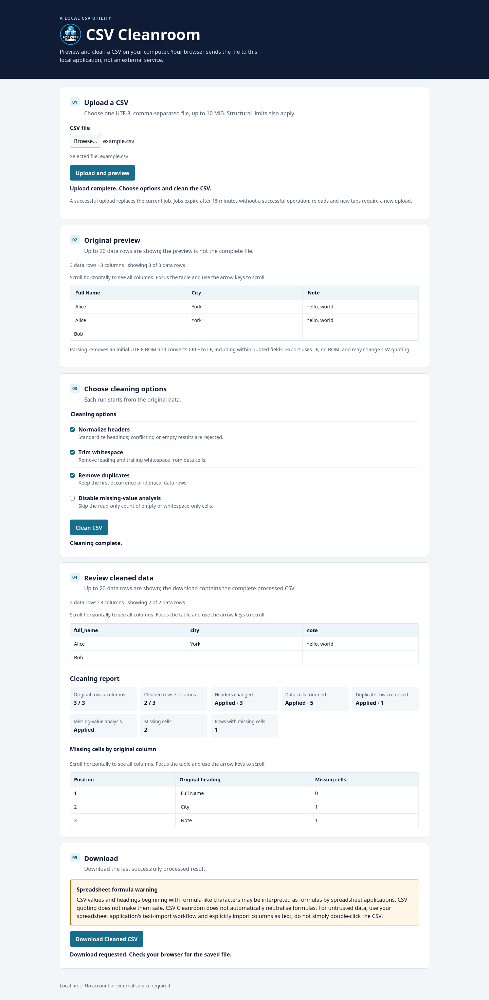

# CSV Cleanroom

CSV Cleanroom is a small local web application for inspecting and cleaning a CSV before further use. It runs a Go server with an embedded browser interface on your computer; normal operation needs no account, external service or internet connection. Obtaining the source, installing Go and initial build preparation may require internet access. Processing locally reduces data sent to services, but does not guarantee absolute privacy.

Upload a CSV to see its filename, dimensions and original preview, then optionally normalise headings, trim data-field whitespace, remove duplicate rows and analyse missing values. Process to see a cleaned preview and report, then download the cleaned CSV. Both previews show up to 20 data rows.



*CSV Cleanroom showing the complete cleaning workflow using the example CSV below.*

## Build and run

Install Go 1.27.4 or a compatible newer Go toolchain. From the source directory:

```sh
go build -o csv-cleanroom ./cmd/csv-cleanroom
./csv-cleanroom
```

On Windows, use `go build -o csv-cleanroom.exe ./cmd/csv-cleanroom` and run `.\csv-cleanroom.exe` in PowerShell. Open [http://127.0.0.1:8080](http://127.0.0.1:8080) manually. If the port is occupied, startup fails. Identify what is using port 8080 and stop it only if appropriate, then retry. Stop CSV Cleanroom with Ctrl+C.


### Release archives

When available, obtain the matching archive and `SHA256SUMS.txt` from the repository’s Releases section: Linux amd64 and macOS arm64 use `.tar.gz`; Windows amd64 uses `.zip`.

On Linux, verify with `sha256sum -c SHA256SUMS.txt --ignore-missing`; on macOS, use `shasum -a 256 -c SHA256SUMS.txt` and compare the matching archive result (entries for archives not downloaded may report missing). On Windows PowerShell, run `Get-FileHash .\<archive-name>.zip -Algorithm SHA256` and compare its hash with the corresponding line in `SHA256SUMS.txt`. Check that the matching archive passes before extracting it; a checksum detects changes but does not authenticate its source.

Extract a tar.gz with `tar -xzf <archive-name>.tar.gz`, then run `./csv-cleanroom` on Linux or macOS. On Windows, extract the zip with File Explorer or `Expand-Archive .\<archive-name>.zip -DestinationPath .\csv-cleanroom-release`, then run the extracted `csv-cleanroom.exe` from PowerShell. If the operating system blocks an executable, inspect its security warning before deciding whether to run it.

## Use

1. Choose a CSV and upload it; inspect the original preview.
2. Select options. Header normalisation, data trimming and duplicate removal default off; missing-value analysis defaults on.
3. Process and review the cleaned preview and report. Each run starts from the original upload: headers are normalised, data fields trimmed, duplicates removed, then missing values analysed, when selected.
4. Download the latest successful result. Its sanitised filename ends in `_cleaned.csv`, with `cleaned.csv` as a fallback.

Correct rejected input or adjust options and retry. An invalid normalised header reports an error; disable normalisation or correct the source. A failed processing attempt retains the last successful result when one exists. A failed replacement upload leaves the previous job intact; a successful upload replaces it.

## CSV format and limits

Input must be UTF-8 comma-separated CSV, with an optional initial UTF-8 BOM. Quoted fields, commas and embedded newlines are supported. Malformed UTF-8 or quotes, inconsistent record widths, empty input and entirely blank headings are rejected. Header-only and single-column files are supported; original blank or duplicate headings are allowed if at least one heading is nonblank. Other delimiters and spreadsheet formats are not supported or automatically detected.

Blank physical lines are ignored; whitespace-only lines are records, not blank lines. The parser normalises CRLF to LF, including in quoted fields. Export is UTF-8 with LF and no file BOM; quoting and line endings may change, so logical values rather than original bytes are preserved.

Independent inclusive limits are 10 MiB per file, 11 MiB multipart request body, 100,000 data rows, 128 columns and 1,000,000 data cells (including empty cells). The upload filename is limited to 255 UTF-8 bytes and multipart part headers to 4 KiB. These limits are not a hard RAM guarantee; memory use depends on data and buffers.

## Processing details

Header normalisation trims Unicode edge whitespace, lowercases, converts Unicode whitespace and ASCII hyphens to underscores, collapses underscores, removes edge underscores and removes unsupported punctuation throughout the heading. Letters and numbers are retained; combining marks are retained only when associated with a preceding letter under the implementation's mark rules. Empty results or collisions reject processing; Unicode canonical equivalence is not guaranteed. Data trimming removes Unicode whitespace at field edges, not interior characters. Duplicate comparison is case-sensitive across entire rows after trimming, with field boundaries respected; the first occurrence and row order are retained. Trim counts include fields in rows subsequently removed as duplicates.

Missing means an empty or Unicode-whitespace-only data field, not strings such as `NULL` or `N/A`. Analysis counts missing cells per column and in total, and rows affected after selected transformations. It does not fill values. The report identifies which operations were applied and gives original and final dimensions and counts.

### Example

Input:

```csv
 Full Name , City , Note 
 Alice , York ,"hello, world"
 Alice , York ,"hello, world"
Bob, ,
```

Select all three transformations and leave missing analysis on. Expected output:

```csv
full_name,city,note
Alice,York,"hello, world"
Bob,,
```

Expected report: 3 original rows, 2 processed rows, 3 columns; 3 headings changed, 5 data fields trimmed (including the duplicate row), 1 duplicate removed; missing counts by column 0, 1, 1, for 2 missing cells in 1 row. These results have been verified using the application and the example CSV above.

## Spreadsheet formula warning

Values **and headings** can contain formula-like content that spreadsheet applications may interpret as formulas. CSV quoting alone does not prevent formula interpretation, and CSV Cleanroom does not neutralise spreadsheet formulas. For untrusted CSV, use your spreadsheet application's text-import workflow and explicitly select text treatment for fields instead of opening the file directly.

## Privacy and local operation

The server listens on loopback only. The application keeps one job in memory and does not intentionally write uploaded data to temporary files, send telemetry or make external requests. A job expires 15 minutes after the last successful operation; successful replacement invalidates the old job, while a failed pre-commit replacement preserves it. Reloading the page or opening a new tab requires another upload; shutting down clears application-managed state. Browsers and operating systems may cache or buffer data, and downloaded files are managed by you. Host and Origin restrictions reduce unwanted browser requests but are not authentication or protection against malicious local processes.

## Verification and development

Manual verification included Ubuntu Studio and native Windows 10. Native Firefox offline use was not verified; Docker offline and native checks provided the accepted compensating evidence. CI has covered Ubuntu, a Fedora container, Windows and macOS ARM64; the Fedora container uses the host Linux kernel. Coverage is not a guarantee for every system.

From the source directory, `go test ./...` runs Go tests and `go build ./...` checks the packages build. `go run ./cmd/csv-cleanroom` runs the application for development. See the [MIT licence](LICENSE).
